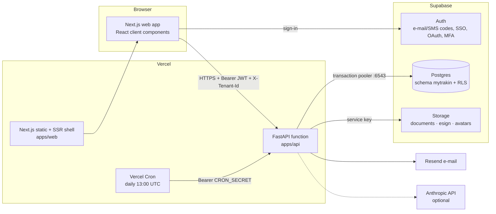

# myTrakIn — technical documentation

Audience: developers and technical reviewers. For what the product does, read [functional.md](functional.md);
for running it in production, [deployment.md](deployment.md).

## 1. Architecture



**Why this shape**

- **The browser never talks to the database.** The `mytrakin` schema is not exposed through Supabase's Data API and the
  `anon`/`authenticated` roles have no privileges on it. Every read and write goes through FastAPI, which is where the
  business rules live (AR/AP visibility, three-way match, approvals, e-signature evidence).
- **Supabase Auth** issues the JWT; the API verifies it (JWKS for ES256/RS256 signing keys, or the legacy HS256 secret).
- **Row-level security is still the last line of defence.** The API switches to a non-privileged role for every
  transaction, so a bug in a query cannot leak another tenant's rows.
- **Serverless on both sides.** Vercel runs the API as one function with Fluid compute; the database connection goes
  through Supabase's transaction pooler, so thousands of short-lived function instances don't exhaust Postgres.

## 2. Repository layout

```
apps/api/app/
  main.py            FastAPI app: middleware (CORS, GZip, security headers, Server-Timing), routers under /v1
  config.py          settings from environment variables (pydantic-settings)
  db.py              async SQLAlchemy engine (asyncpg), NullPool, pooler-safe prepared statements; Db helper
  deps.py            request context (Ctx) and the per-request transaction dependencies
  security.py        Supabase JWT verification (JWKS or HS256), MFA level
  errors.py          one error shape; Postgres SQLSTATE → HTTP mapping
  responses.py       orjson responses (Decimal-safe)
  utils.py           client IP (Vercel headers), device label, money rounding, week math, tokens
  routers/           one file per area (me, dashboard, companies, consultants, projects, contracts, timesheets,
                     invoices, people_pay, esign, public, compliance, data, admin, network, insights, platform, cron)
  services/          email (Resend), storage (Supabase Storage), esign (links, certificate PDF, sealing),
                     invoicing, timesheet_checks, csv_io (templates, validation, importers)
apps/api/tests/      pytest: access rules and end-to-end flows against a database built from the migrations
apps/web/src/
  app/               App Router pages; (app)/ = signed-in area with the shell; login, signup, register, sign = public
  components/        AppShell, DataTable (search/filter/sort/list-cards/CSV), forms, Attachments, SignaturePad, ui
  lib/               api client, session context, SWR-style cache, formatting, week helpers, Supabase client
supabase/migrations/ 0100 foundation · 0200 business · 0300 compliance/e-sign/network/audit · 0400 security · 0500 storage/defaults
supabase/seed.sql    demo workspace (staging and training only)
```

## 3. Request lifecycle

1. The browser signs in with Supabase Auth and holds a short-lived access token (JWT, 1 hour, auto-refreshed).
2. Each API call sends `Authorization: Bearer <token>` and `X-Tenant-Id` (the selected workspace).
3. `security.decode_token` verifies signature, expiry, audience and issuer, and reads `sub`, `email` and `aal`.
4. `deps.tenant_db` opens **one transaction** and runs a single statement:

   ```sql
   select a.*, mytrakin.begin_request(:uid, a.tenant_id, a.role, a.company_id, a.consultant_id, :ip, :ua)
     from mytrakin.resolve_access(:uid, :tid) a
   ```

   `resolve_access` (SECURITY DEFINER) finds the caller's active membership; `begin_request` does
   `SET LOCAL ROLE mytrakin_api` and stores the context in transaction-local settings (`app.tenant_id`, `app.role`, …).
   One round trip, no extra latency.
5. If the user turned MFA on (verified factor) and the token's `aal` isn't `aal2`, the request stops with `mfa_required`. Then the company's status (waiting for activation → only profile paths), ownership and the person's module permissions (`app/permissions.py`) are checked.
6. The router runs plain SQL. RLS policies filter rows; the router additionally hides columns the role may not see.
7. The transaction commits (or rolls back on any error) and the connection returns to the pooler.

Other entry points use the same mechanism with a different role: `platform_db` (owner console), `user_db` (signed in,
no workspace yet), `open_public` (registration forms), `open_signer` (e-signature link), `open_system` (cron).

## 4. Security model

| Layer | What it does |
|---|---|
| Network | HTTPS only (Vercel). HSTS, CSP, `X-Frame-Options: DENY`, `nosniff`, strict referrer policy on both apps. |
| Identity | Supabase Auth. Methods: e-mail code, SMS code, SAML SSO, Google, Microsoft, password. TOTP MFA, the user's choice (API-enforced once turned on). |
| Schema exposure | `mytrakin` schema not in the Data API; `anon`/`authenticated` revoked. |
| Role switch | API transactions run as `mytrakin_api` (NOLOGIN, NOINHERIT, no BYPASSRLS). |
| Tenant isolation | A RESTRICTIVE policy on every tenant table: `tenant_id = ctx_tenant()`. No permissive policy can widen it. |
| Role rules | PERMISSIVE policies per table and role (e.g. vendors see only AP invoices addressed to their company). |
| Column rules | API hides rates/amounts by role (`Ctx.sees_bill_rate`, `sees_pay_rate`, `_hide()` in invoices). |
| Audit | Trigger `audit_row()` on 26 tables writes who/what/when/IP/device and before→after diffs. `mytrakin_api` cannot update or delete audit rows. Secrets (token/OTP hashes, signature images) are stripped. |
| Secrets | Service-role key only in the API's environment. Signing tokens and OTPs are stored as SHA-256 hashes. |

Cross-tenant features (network, platform console, e-sign lookup) use small SECURITY DEFINER functions that check the
caller themselves: `resolve_access`, `my_tenants`, `is_platform_admin_user`, `active_tenant_ids`, `esign_lookup`,
`signer_envelope`, `envelope_visible`, `visible_profile`, `shared_workspaces`, `platform_tenant_stats`,
`log_notification`, `mark_notification`. Each has `set search_path` pinned and `execute` granted only to `mytrakin_api`.

### Role matrix (rows visible)

| Data | Admin | Finance | Acct mgr | Legal | HR | Approver | Viewer | Vendor | Client | Consultant |
|---|---|---|---|---|---|---|---|---|---|---|
| Companies | all | all | all | all | all | all | all | own | own | own chain |
| Consultants | all | all | all | all | all | all | all | own employees | – | self |
| Placements (rates) | all (both) | all (both) | all (bill) | all (both) | all (–) | all (–) | all (–) | own (pay) | own (bill) | own (none) |
| Timesheets | all | all | all | all | all | all | all | own employees | – | self |
| AR invoices | all | all | all | all | all | all | all | – | own | status only |
| AP invoices | all | all | all (no amounts) | all (no amounts) | all (no amounts) | all (no amounts) | all (no amounts) | own | – | status only |
| Contracts | all | all | all | all | all | all | all | own | own | own |
| Audit log | ✓ | ✓ | – | ✓ | – | – | – | – | – | – |

Write permissions follow `can(...)` in [0400_security.sql](../supabase/migrations/20261011000400_security.sql) and
`ctx.require(...)` in each router; both must agree, so a missing check in one place still fails closed.

## 5. The AR/AP-only rule

A placement stores exactly two money terms: `bill_rate` (what **you** bill your AR customer) and `pay_rate` (what **you**
pay your AP payee). The end client is a name (`end_client_company_id`) with no rate column at all — there is nothing to
leak. The payment-flow view shows that hop as a dashed, masked card. Consultants never receive rates or amounts:
`/me/consultant` returns statuses and dates only.

## 6. Data model

All tables live in schema `mytrakin`; every tenant table has `tenant_id` with an index leading on it.

| Area | Tables |
|---|---|
| Platform | `tenants`, `tenant_signups`, `platform_admins` |
| People & access | `profiles` (one per auth user, shared across tenants), `memberships` (role per tenant, invitations), `counters` |
| Parties | `companies` (client, prime_vendor, vendor, end_client; active/inactive with reason), `consultants` (W-2 FT, W-2 contract, C2C, 1099; onboarding/active/former, checklist JSON) |
| Contracts | `agreements` (MSA, subcontract, ICA, NDA, offer), `sows` (we_bill / we_pay, ceiling, prior invoiced/paid for imports, `flows_from_sow_id`), `sow_amendments` |
| Work | `projects`, `placements`, `timesheets` (one per consultant-week), `timesheet_entries` (per placement-day), `expenses`, `time_off` |
| Money | `invoices` (AR/AP, `pay_when_paid_of`, `approved_hours` for 3-way match), `payments`, `collection_notes`, `payroll_lines`, `referral_agreements`, `referral_payments`; views `invoice_balances` (paid, balance, days late, `live_status`) and `sow_burn` |
| Compliance | `documents` (file index), `tracked_documents` (expiry tracking), `policies`, `policy_acceptances`, `registrations` |
| E-signature | `envelopes`, `envelope_signers`, `signature_events` (append-only evidence) |
| Messaging | `reminder_rules`, `notifications` (log + dedupe), `import_jobs` |
| Network | `connections`, `posts`, `messages` (scoped to the person, not the tenant) |
| Audit | `audit_log` |

`invoice_balances.live_status` is the single source of truth for invoice state:
`void → paid → exception → held (pay-when-paid, AR unpaid) → scheduled → overdue / overdue_part_paid → part_paid → ready_to_pay → open`.

## 7. Key flows in code

| Flow | Where |
|---|---|
| Timesheet checks (daily max, allocation, weekend, overtime, placement term, SOW value) | `services/timesheet_checks.py` (pure functions, unit-testable) |
| Invoice generation from approved hours (idempotent; skips hours already invoiced) | `services/invoicing.generate_invoices` |
| Payment recording; releasing pay-when-paid AP when AR is paid in full | `services/invoicing.record_payment` |
| Vendor invoice three-way match | `routers/invoices.submit_vendor_invoice` |
| E-signature: link, OTP, consent, sign, seal, certificate | `routers/esign.py`, `routers/public.py`, `services/esign.py` |
| Daily reminders (documents, timesheets, AR, contracts, e-sign, policies) | `routers/cron.py` — per-tenant transaction, advisory lock, dedupe keys |
| CSV import (dry run, savepoint per row, natural-key upsert) | `routers/data.py`, `services/csv_io.py` |
| Smart suggestions | `routers/insights.py` (rules; optional Anthropic call grounded only in the caller's suggestions) |

### E-signature evidence

Each signer gets a random 256-bit token (only its SHA-256 is stored). Opening the link logs `viewed` with IP
(`x-vercel-forwarded-for` → `x-real-ip` → `x-forwarded-for` → socket), device and Vercel geo headers. The signer proves
control of the e-mail with a 6-digit code (hashed with the signer id, 10-minute expiry, 5 attempts), accepts the
ESIGN/UETA disclosure (its hash is logged), then signs (typed or drawn). On the last signature the API builds a
certificate of completion (fpdf2), appends it to the original PDF (pypdf), stores the sealed PDF and its SHA-256, flips the
agreement/SOW/amendment status, and e-mails a 7-day download link to everyone.

### File uploads and the 4.5 MB limit

Vercel Functions accept request and response bodies up to 4.5 MB. Files up to 4 MB are posted to the API as
multipart forms. Larger files (up to 25 MB — attachments and e-signature PDFs) use a signed upload: `POST /v1/uploads`
returns a one-time Supabase Storage URL, the browser `PUT`s the file there, then `POST /v1/files/confirm` (or
`POST /v1/envelopes` with `document_path`) checks the path belongs to the tenant and record, reads the object and
stores its size and SHA-256. Downloads always use 5–10-minute signed Storage URLs, never the function. In local
development without Storage, `/v1/uploads/local` stands in for the signed URL. Profile photos, policy PDFs, registration
documents and CSV imports are limited to 4 MB.

## 8. Performance

- **One round trip to start a request**; `NullPool` + Supavisor transaction mode; `statement_cache_size=0` and unique
  prepared-statement names (required by transaction pooling).
- **Region pinning**: both Vercel projects in `iad1` next to a Supabase project in `us-east-1` (change both together).
- **orjson** responses, **GZip** over 1 KB, `Server-Timing` header for every response (see it in the browser's network tab).
- **Indexes** lead with `tenant_id` and the common filter (`status`, `week_start`, `due_on`, `expires_on`).
- **Web**: pages are static shells (prerendered) that fetch data client-side through a small stale-while-revalidate cache,
  so navigation is instant on repeat visits; lists page client-side (50 rows at a time) after one fetch.
- Heavy lists are capped server-side (`limit 2000`, audit `limit 500` with keyset paging via `before_id`).

## 9. Errors

Every error is `{"error": {"code", "message"}}` with a message written for the end user. Postgres errors are mapped:
`42501` → 403, `23505` → 409 duplicate, `23503` → 409 in use, `23514`/`23502`/`22P02` → 422. Unknown database errors are
logged with SQLSTATE and returned as a generic 500.

## 10. Testing

`apps/api/tests` builds a **fresh database from the real migrations and seed** for every run
(`scripts/db-local-reset.sh`), creates auth users (which claims the seeded invitations), signs HS256 test tokens and
calls the API in-process through `httpx.ASGITransport`. Covered: tenant isolation, outsider access, MFA enforcement,
vendor/consultant visibility, the AR/AP rule, timesheet → invoice → payment, rejection, full e-signature with IP
capture, public registration and approval, SaaS sign-up approval, CSV dry run/import/export, compliance renewals,
user invites and the audit trail, network, suggestions, cron idempotency, file soft-delete, payroll, referrals, 1099,
expense and time-off approvals.

```bash
TEST_DATABASE_URL=postgresql://postgres@localhost:5432/mytrakin_test make test
```

The web app is type-checked and production-built in CI; release testing also covers a browser walk-through of every
page per role (see [training-guide.md](training-guide.md) exercises — they double as a UAT script).

## 11. Extending

**New column or table**
1. Add a new migration `supabase/migrations/<timestamp>_<name>.sql` (never edit an applied one).
2. For a new tenant table: `tenant_id uuid not null references tenants`, enable RLS, add the restrictive
   `tenant_isolation` policy and the role policies, add it to the audit trigger list, grant to `mytrakin_api`.
3. Run `make db-reset test`.

**New endpoint**
1. Add a function to the right router (or a new router registered in `main.py`).
2. Take `db: TenantDb = Depends(tenant_db)`; call `db.ctx.require(...)` for writes; hide columns by role.
3. Use `cast(:p as type)` for optional filters (`cast(:x as text) is null or col = :x`); never `:p::type` in `text()`.
4. Add a test in `tests/`, then `make api-docs` to refresh the API reference.

**New page**
1. Add `apps/web/src/app/(app)/<route>/page.tsx` (`"use client"`), use `useApi()` and `DataTable`.
2. Add the nav entry in `components/AppShell.tsx` with a `show` rule matching the API's roles.
3. Pages may only export `default` — put shared components in `src/components`.

## 12. Configuration reference

API (`apps/api/.env.example`): `DATABASE_URL`, `DB_POOL`, `SUPABASE_URL`, `SUPABASE_JWT_SECRET`,
`SUPABASE_SERVICE_ROLE_KEY`, `WEB_ORIGIN`, `EXTRA_CORS_ORIGINS`, `RESEND_API_KEY`, `EMAIL_FROM`, `CRON_SECRET`,
`ANTHROPIC_API_KEY`, `AI_MODEL`, `SIGNING_LINK_DAYS`, `ENVIRONMENT`.

Web (`apps/web/.env.example`): `NEXT_PUBLIC_API_URL`, `NEXT_PUBLIC_SUPABASE_URL`, `NEXT_PUBLIC_SUPABASE_ANON_KEY`
(public by design; the anon key can't reach the `mytrakin` schema).

## 13. Known limits and next steps

- **Passkeys**: Supabase Auth doesn't offer passkeys/WebAuthn as a sign-in method as far as we know (October 2026);
  TOTP MFA is used instead. Revisit when Supabase ships it.
- **SMS** codes need an SMS provider configured in Supabase (Twilio, MessageBird, Vonage, Textlocal).
- **SAML SSO** needs a Supabase plan that includes it and per-customer setup (`supabase sso add`).
- **Realtime**: messages poll every 15 s while a conversation is open; switch to Supabase Realtime broadcast if needed.
- **Invoice PDFs** are not generated yet (the e-mail carries the details); add a PDF template in `services/` when wanted.
- **Payroll** is a record of results from your payroll provider, not a payroll engine.
